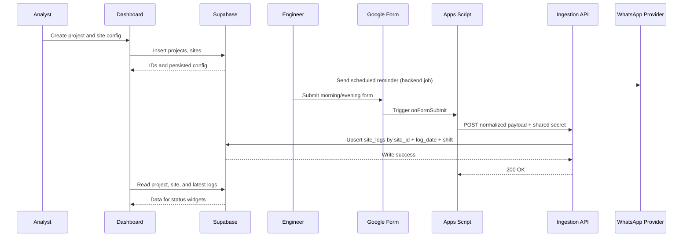

# Volecule V1 Information Flow

Date: 2026-07-18
Scope: 1-week minimal v1 aligned to next_steps_dashboard_plan

## 1) Purpose

This document defines the full flow of information for v1:

1. Which entities exist
2. Which actors perform which actions
3. How data is populated and transformed
4. Where validations happen
5. How data is consumed in dashboard views
6. What failures can occur and how they are handled

The goal is implementation clarity with minimal scope.

## 2) Actors and Responsibilities

1. Analyst

- Creates projects
- Creates sites under projects
- Configures per-site Google Form URLs
- Configures per-site reminder times and WhatsApp target
- Monitors dashboard status

2. Site Engineer

- Submits morning and evening Google Forms
- Provides structured daily updates

3. Integration Layer (Google Apps Script)

- Listens to form submit events
- Normalizes form payload
- Calls backend ingestion endpoint

4. Volecule Backend

- Validates ingestion requests
- Maps payload into database schema
- Upserts site logs
- Runs reminder sender

5. Supabase (Postgres)

- Stores source-of-truth entities and logs
- Enforces uniqueness and referential integrity

6. WhatsApp Provider

- Receives outbound reminder messages
- Delivers reminder to configured site target

## 3) Core Entities

Minimal entities only.

### 3.1 Projects

Purpose: container for work context and client identity.

Primary fields:

- id
- name
- client_name
- status
- created_by
- created_at

Cardinality:

- One project has many sites

### 3.2 Sites

Purpose: operational unit where daily logs and reminders happen.

Primary fields:

- id
- project_id
- name
- public_code
- timezone
- google_form_url_morning
- google_form_url_evening
- reminder_time_morning
- reminder_time_evening
- whatsapp_target
- status
- created_at

Cardinality:

- One site belongs to one project
- One site has many logs

### 3.3 Site Logs

Purpose: canonical twice-daily operational record.

Primary fields:

- id
- site_id
- log_date
- shift (morning or evening)
- headcount_json
- targets_selected_json
- targets_achieved_json
- free_notes
- source
- external_submission_id
- source_payload_json
- created_at

Integrity rules:

- unique on site_id + log_date + shift
- unique on site_id + external_submission_id when external_submission_id exists

## 4) Action to Data Population Matrix

1. Analyst creates project

- Input: name, client_name
- Table written: projects
- Output: project row with id

2. Analyst creates site

- Input: project_id, name, timezone, form URLs, reminder times, whatsapp target
- Table written: sites
- Output: site row with id

3. Site engineer submits morning/evening form

- Input: form response
- No direct DB write from Google Forms
- Output: trigger event in Apps Script

4. Apps Script forwards submission

- Input: raw response from Google Form
- Action: normalize to backend payload
- Output: HTTPS request to ingestion endpoint

5. Backend ingests payload

- Validates shared secret
- Validates required fields
- Resolves site by site_id or site_code
- Resolves shift and log_date
- Upserts site_logs row
- Stores normalized and raw payload in source_payload_json

6. Reminder runner executes

- Reads sites with configured reminder times
- Computes due reminders by timezone and current time
- Sends WhatsApp message using correct site form URL

7. Dashboard reads state

- Projects list from projects
- Sites list from sites
- Latest morning/evening status from site_logs

## 5) End-to-End Flow (Happy Path)

## 5.1 Setup Flow

1. Analyst creates a project
2. Analyst creates one site under that project
3. Analyst sets morning and evening form links
4. Analyst sets morning and evening reminder times
5. Analyst sets whatsapp target for site

Result:

- Project and site are ready for daily operation.

## 5.2 Daily Capture Flow

1. Morning reminder is sent
2. Site engineer opens morning Google Form and submits
3. Apps Script sends normalized payload to backend
4. Backend upserts morning row in site_logs
5. Evening reminder is sent
6. Site engineer submits evening Google Form
7. Backend upserts evening row in site_logs

Result:

- One morning and one evening row for site date.

## 5.3 Dashboard Consumption Flow

1. Dashboard loads projects and sites
2. Dashboard queries latest log entries
3. Dashboard renders status indicators:

- Morning submitted or missing
- Evening submitted or missing
- Last updated timestamp

## 6) Ingestion Contract (Minimal)

Endpoint:

- POST /api/integrations/google-forms/submit

Authentication:

- Shared secret header required

Required payload fields:

- site_id or site_code
- shift
- external_submission_id
- submitted_at
- form_values object

Optional payload fields:

- headcount
- targets_selected
- targets_achieved
- free_notes

Server mapping:

- log_date = date derived from submitted_at in site timezone
- shift = morning or evening from payload
- headcount_json = mapped object
- targets_selected_json = mapped object/array
- targets_achieved_json = mapped object/array
- free_notes = mapped text
- source = google_form
- external_submission_id = from payload
- source_payload_json = full payload snapshot

Upsert key:

- site_id + log_date + shift

Idempotency key:

- site_id + external_submission_id when available

## 7) Validation Rules

1. Analyst setup validation

- project name required
- client name required
- site name required
- timezone required
- at least one form URL required before reminders can run

2. Ingestion validation

- shared secret must match
- site_id/site_code must resolve to an active site
- shift must be morning or evening
- submitted_at must be parseable timestamp
- external_submission_id required

3. Write validation

- reject impossible shift values
- reject rows that violate uniqueness unless upsert path is used

## 8) Failure Paths and Handling

1. Invalid shared secret

- Action: reject request with unauthorized status
- Effect: no db write

2. Unknown site_id/site_code

- Action: reject request with validation error
- Effect: no db write

3. Duplicate form submission

- Action: upsert existing site_logs row
- Effect: one canonical row remains

4. Partial payload

- Action: store available fields, set missing fields null
- Effect: row exists with incomplete json, visible for manual review

5. WhatsApp send failure

- Action: log server error in app logs
- Effect: reminder not delivered; analyst retries manually in v1

## 9) Data Lifecycle

1. Create phase

- Analyst creates project and site

2. Capture phase

- Forms submit twice daily
- Logs get upserted into site_logs

3. Read phase

- Dashboard and weekly reporting read from site_logs

4. Update phase

- New submission for same site/date/shift updates canonical row

5. Retention phase

- Logs retained for historical reporting

## 10) Query Views Needed for UI

1. Project list view

- project id, name, client, site count

2. Site list view

- site id, project id, name, timezone, reminder times, active status

3. Daily status view per site

- latest morning log for today
- latest evening log for today
- last submission timestamp

4. Latest activity feed

- recent site_logs rows ordered by created_at desc

## 11) Sequence Diagram

## 12) Implementation Checklist Coverage

Covered in this document:

1. Entities
2. Actors
3. Actions and ownership
4. Data population paths
5. Validation and constraints
6. Failure behavior
7. Read models for dashboard
8. End-to-end sequence

Not included intentionally in v1:

1. Complex role matrix
2. Advanced dispatch audit tables
3. Extended financial models
4. Schedule propagation logic
